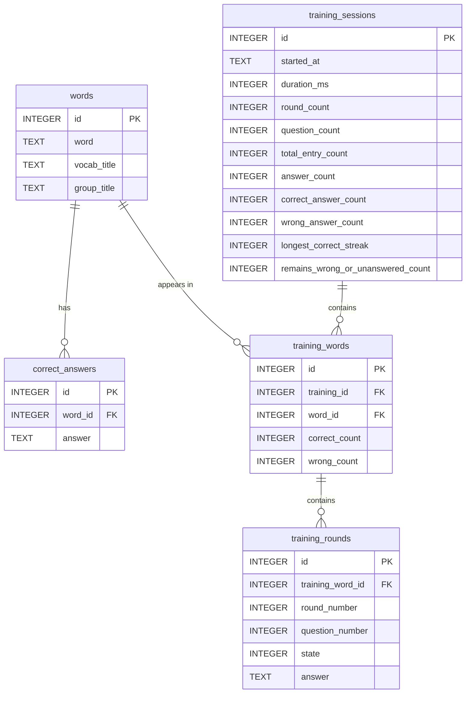

# Database Architecture

## Overview

The application uses an SQLite database to persist vocabulary training statistics between application sessions.

Database operations are handled by `StatisticsDBHandler`, which is responsible for initializing the database, creating its tables, saving training data, and retrieving statistics.

The database stores information about vocabulary entries, their accepted answers, training sessions, individual words included in training sessions, and the results of individual training rounds.

## Database Schema

The database consists of five tables:

| Table               | Description                                                                      |
| ------------------- | -------------------------------------------------------------------------------- |
| `words`             | Stores vocabulary entries and their vocabulary context.                |
| `correct_answers`   | Stores accepted correct answers associated with vocabulary entries.              |
| `training_sessions` | Stores summary information about individual training sessions.                   |
| `training_words`    | Stores per-word results within individual training sessions.                     |
| `training_rounds`   | Stores the results of individual rounds for each word during a training session. |

### Entity Relationship Diagram

## Table Descriptions

### words

Stores vocabulary entries together with their vocabulary and group context.

| Column        | Description                                   |
| ------------- | --------------------------------------------- |
| `id`          | Unique identifier for the vocabulary entry.   |
| `word`        | Vocabulary entry.                             |
| `vocab_title` | Title of the vocabulary containing the entry. |
| `group_title` | Title of the group containing the entry.      |

The combination of `word`, `vocab_title`, and `group_title` must be unique. This allows the same word to exist in different vocabulary files or groups.

### correct_answers

Stores accepted correct answers for vocabulary entries.

| Column    | Description                                 |
| --------- | ------------------------------------------- |
| `id`      | Unique identifier for the answer.           |
| `word_id` | References the associated entry in `words`. |
| `answer`  | An accepted correct answer.                 |

Each vocabulary entry can have multiple accepted correct answers. The combination of `word_id` and `answer` must be unique.

### training_sessions

Stores summary statistics for each completed training session.

| Column                              | Description                                          |
| ----------------------------------- | ---------------------------------------------------- |
| `id`                                | Unique identifier for the training session.          |
| `started_at`                        | Date and time when the session started.              |
| `duration_ms`                       | Session duration in milliseconds.                    |
| `round_count`                       | Number of training rounds.                           |
| `question_count`                    | Number of questions.                                 |
| `total_entry_count`                 | Total number of vocabulary entries included.         |
| `answer_count`                      | Total number of answers.                             |
| `correct_answer_count`              | Number of correct answers.                           |
| `wrong_answer_count`                | Number of incorrect answers.                         |
| `longest_correct_streak`            | Longest consecutive correct-answer streak.           |
| `remains_wrong_or_unanswered_count` | Number of entries remaining incorrect or unanswered. |

This table provides an overview of the overall training session without requiring individual word results to be aggregated.

### training_words

Stores the results for individual vocabulary entries within a training session.

| Column          | Description                                                    |
| --------------- | -------------------------------------------------------------- |
| `id`            | Unique identifier for the training-word record.                |
| `training_id`   | References the associated session in `training_sessions`.      |
| `word_id`       | References the associated vocabulary entry in `words`.         |
| `correct_count` | Number of correct answers for this entry during the session.   |
| `wrong_count`   | Number of incorrect answers for this entry during the session. |

The combination of `training_id` and `word_id` must be unique. Consequently, each vocabulary entry has at most one record per training session.

### training_rounds

Stores information about individual rounds for each vocabulary entry during a training session.

| Column             | Description                                           |
| ------------------ | ----------------------------------------------------- |
| `id`               | Unique identifier for the training-round record.      |
| `training_word_id` | References the associated record in `training_words`. |
| `round_number`     | Training round number.                                |
| `question_number`  | Question number within the round.                     |
| `state`            | Integer representation of the round result state.     |
| `answer`           | Answer provided during the round.                     |

The `state` column stores the integer representation of the corresponding training state. The `answer` column is nullable.

## Database Operations

`StatisticsDBHandler` provides the database operations used by the application.

### Initialization

When the database is initialized, the handler:

1. Validates the database path.
2. Creates the database directory if it does not exist.
3. Opens an SQLite database connection using Qt's `QSQLITE` driver.
4. Enables SQLite foreign-key enforcement.
5. Creates the database tables if they do not already exist.

Table creation is performed inside a database transaction.

### Saving Training Statistics

The `saveTraining()` operation stores the results of a training session.

The operation performs the following steps:

1. Inserts a new record into `training_sessions`.
2. Finds or creates the corresponding vocabulary entries in `words`.
3. Inserts any accepted answers that are not already stored in `correct_answers`.
4. Inserts per-word results into `training_words`.
5. Inserts individual round results into `training_rounds`.
6. Commits the transaction if all operations succeed.

The entire save operation is performed within a single database transaction. If an operation fails, the transaction is rolled back to prevent partially saved training data.

### Querying Training History

The `queryDatabase()` operation retrieves training history for a requested set of vocabulary entries.

For each entry, the query retrieves:

* The most recent training date.
* The total number of correct answers.
* The total number of answers.
* Whether the entry already exists in the database.

Entries without previous training history are also included in the result, with their history initialized accordingly.

Queries are processed in batches of up to 5,000 entries.

### Retrieving Top and Worst Performing Entries

The handler also provides operations for retrieving the best and worst performing vocabulary entries across all training sessions.

The results are based on the ratio of correct answers to total answers, with the total number of answers used as a secondary sorting criterion.

Entries belonging to vocabularies whose titles contain `debug` are excluded from these rankings.

## Database Integrity

The database uses primary keys, foreign keys, and unique constraints to maintain data integrity.

Foreign-key enforcement is explicitly enabled when the database connection is opened.

The save operation uses transactions to ensure that a training session and its associated records are saved together or rolled back if an error occurs.

## Technologies

* SQLite
* Qt SQL module
* Qt `QSQLITE` database driver
