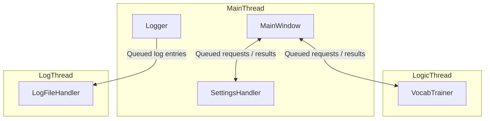
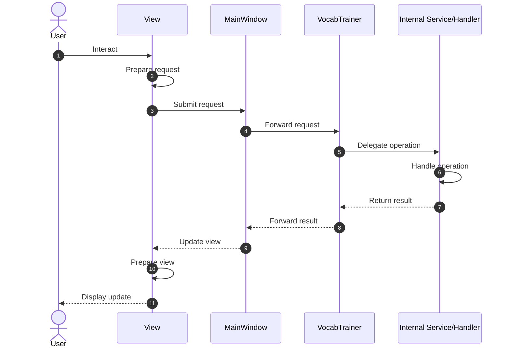

# VocabTrainer

## Overview

VocabTrainer is a vocabulary training application built with C++ and Qt.

The application provides vocabulary management and training functionality, with support for loading vocabulary data and tracking training-related information. Training statistics are persisted in an SQLite database, allowing training-related data to be retained between application sessions.

## Architecture

The application is structured around separate components, each responsible for a specific area of functionality. The components are initialized and connected in `main.cpp`, which establishes the application's overall architecture and communication paths.

The main components are organized into three groups:

* **Application-wide components** – Provide shared functionality used across the application.
* **Application logic** – Handles the application's core functionality and business logic.
* **User interface** – Handles user interaction and presentation.

The components communicate primarily through Qt's signal-slot mechanism, allowing requests and results to be exchanged asynchronously without requiring direct synchronous calls between components.

### Main components

The application consists of the following main components:

#### Application-wide components
* `Logger` – Responsible for emitting log entries from different parts of the application.

* `SettingsHandler` – Responsible for managing application settings.

* `LogFileHandler` – Responsible for reading and writing log entries to the log file.

#### Application logic

`VocabTrainer` is the public interface between `MainWindow` and the application logic. It receives requests forwarded by `MainWindow` on behalf of the views, delegates them to the appropriate internal services and handlers, and returns the results to `MainWindow`.

`VocabTrainer` consists of the following services and handlers:

* `LogService` – Handles log-related operations, including retrieving and filtering log entries.

* `VocabFileHandler` – Responsible for reading vocabulary data from vocabulary files.

* `DataService` – Handles vocabulary data loading and processing, providing vocabulary data to other application components.

* `TrainingHandler` – Responsible for managing vocabulary training operations.

* `StatisticsService` – Handles training statistics and related data operations, including storing and retrieving training statistics from the SQLite database.

* `HeuristicsService` – Handles heuristic-based vocabulary refining and ordering during training.

#### User interface

`MainWindow` is the central UI coordinator, managing the application views and serving as the intermediary between the views and `VocabTrainer`. It forwards requests from the views to `VocabTrainer` and routes the returned results to the appropriate views.

`MainWindow` consists of the following views and services:

* `MainView` – Handles the main application view and user interaction related to vocabulary and training.

* `SettingsView` – Provides the user interface for viewing and modifying application settings.

* `LogView` – Provides the user interface for viewing and filtering log entries.

* `DialogService` – Provides centralized handling of modal message boxes, displaying error, warning and other messages at the request of `MainWindow`.

### Threading model

The application uses separate threads to isolate the user interface, application logic and log file operations.

* **MainThread** – Runs the Qt application event loop and hosts `MainWindow`, `SettingsHandler` and `Logger`.

* **LogicThread** – Hosts `VocabTrainer` and handles application logic independently of the UI thread.

* **LogThread** – Hosts `LogFileHandler` and performs log file operations independently of the other components.

Communication between components across threads is handled using queued signal-slot connections. This allows requests and results to be processed asynchronously while keeping the UI responsive.

### Database architecture

The database architecture is depicted in detail [here](Documentation/Architecture/database_architecture.md).

## Application workflows

Generally, any action initiated by the user from a view follows the below workflow.

The following sequence diagrams describe the actual application workflows.

### Log query

Describes how log entries are retrieved, filtered and displayed in the log view.

[View log query sequence diagram](Documentation/Workflows/log_query.md)

### Vocabulary loading

Describes how vocabulary data is loaded from a file and made available to the main view.

[View vocabulary loading sequence diagram](Documentation/Workflows/vocab_load.md)

### Training

Describes how training data is handled and how the training flow works.

[View training sequence diagram](Documentation/Workflows/training.md)

## Technologies

* C++
* Qt
* SQLite
* CMake
* Mermaid (architecture diagrams)
